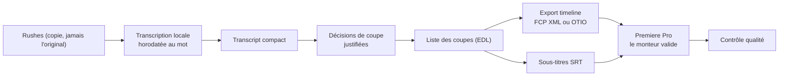

# AUTOPILOT — Note de concept

## Tranquility Suite · Cellule Vidéo L'Étudiant

**Version V1 — 20/10/2026**
**Statut : en réflexion (non cadré).** Ce document n'est pas une fiche produit. Il le deviendra seulement après le go/no-go du prototype AutoClip (voir « Conditions de passage en fiche produit »).

> **Mission** : automatiser les tâches répétitives de montage autour d'Adobe Premiere Pro grâce à une IA locale, sans abonnement, en laissant toujours la décision finale au monteur.

---

## Vision

AUTOPILOT est un copilote de montage pour la Cellule Vidéo.

Contrairement aux solutions SaaS fondées sur des abonnements et des traitements cloud, AUTOPILOT fonctionne **en local par défaut**, protège les rushes et s'intègre à la Tranquility Suite.

L'objectif n'est pas de remplacer le monteur, mais de lui faire gagner plusieurs heures par projet en automatisant les tâches à faible valeur ajoutée.

**Positionnement : « L'autopilote du montage vidéo. »** Un assistant qui prépare les séquences, nettoie les interviews, structure les timelines et accompagne le monteur.

---

## Principes fondateurs

- IA locale par défaut ; aucun nouveau paiement (règle 13 du labo R&D). Seuls les services déjà payés (abonnement Claude, Cursor) sont utilisables.
- Fonctionne hors ligne pour tout ce qui touche aux rushes.
- **AUTOPILOT propose, le monteur valide.** Chaque décision automatique est justifiée et réversible.
- Les rushes originaux ne sont jamais modifiés.
- Architecture modulaire.
- Compatible avec le workflow Premiere Pro de l'équipe.
- Respect des documents fondateurs : Vision Produit, Workflow Captif, Design Reference.

---

## Premier jalon proposé (à confirmer après les tests)

Le MVP d'origine comptait cinq modules. Il est ramené à un premier jalon testable :

1. **Smart Cut** : suppression des silences et des hésitations (« euh », « hum »), en conservant les respirations naturelles, avec des profils de montage définis par la Suite (Interview, Podcast, YouTube…) et non par chaque utilisateur (Loi 1 du Workflow Captif).
2. **Smart Captions** : transcription locale, sous-titres synchronisés au mot, export SRT importable dans Premiere.
3. **Sortie** : une timeline importable et modifiable dans Premiere (format FCP XML ou OTIO, à tester), pas un fichier vidéo figé.

Chaque coupe proposée porte sa justification, pour que le monteur valide vite.

---

## Modules suivants (gardés, non planifiés)

- **Smart Takes** : détection des mauvaises prises, des recommencements, des phrases incomplètes ; suggestions de nettoyage.
- **Smart Timeline** : marqueurs automatiques, découpage par sujet, couleurs, commentaires.
- **Smart Chapters** : chapitres YouTube et résumé de chaque section.

## Vision V2 (gardée, non planifiée)

Détection des meilleurs extraits · génération de Shorts / Reels · recadrage automatique · zoom intelligent · détection du locuteur · recherche de B-roll · multicam intelligente · détection des erreurs de montage · contrôle qualité avant export.

---

## Architecture envisagée

Hypothèse de travail issue de l'évaluation de video-use : un **moteur indépendant** qui produit une timeline importable dans Premiere, plutôt qu'un plugin UXP en premier. Le plugin UXP reste une option pour plus tard.

Le moteur pourra être partagé avec les autres apps de la Suite (piste à étudier, non décidée).

### Technologies envisagées (aucune vérifiée ni retenue à ce stade)

Python · FFmpeg · Faster-Whisper · WhisperX · Qwen · YOLO · PySceneDetect · PaddleOCR · UXP (Adobe Premiere, option ultérieure).

Toute dépendance passe par une fiche du labo R&D (`tranquility-rd`) avant d'entrer dans l'app.

---

## Intégration dans la Tranquility Suite

- **Profil et préférences** : AUTOPILOT lit le profil et écrit `session.json` comme toutes les apps de la Suite. **Launcher n'est jamais requis** (D1, D5).
- **Reviewer** : annotations automatiques (piste).
- **Transporter** : préparation des médias (piste).
- **ARK** : archivage enrichi par les métadonnées (piste).
- **Monday** : lecture du statut et du format via le Workflow Passeport (piste, doctrine non écrite).

---

## Pistes du labo R&D liées

| Fiche | Verdict | Lien avec AUTOPILOT |
|---|---|---|
| `RD_AUTOCLIP_V1` | prototype | Test go/no-go sur une interview française de 20 à 40 min, 100 % local, dossier isolé |
| `RD_VIDEO_USE_V1` | abandon | Pipeline retenu comme modèle : transcript compact, coupes justifiées, EDL, rendu ou export, contrôle |
| `RD_HYPERFRAMES_V1` | prototype | Animations et habillages, en complément |

---

## Conditions de passage en fiche produit

1. Résultat du prototype AutoClip consigné dans sa fiche.
2. Test de la méthode du pipeline (fiche `RD_VIDEO_USE_V1`) sur un extrait de 5 à 10 min : transcription locale, coupes justifiées, timeline importée dans Premiere.
3. Validation de la Présidence.

La fiche produit devra alors inclure la checklist d'identité visuelle : **Mission Patch**, **splash screen**, **animation d'ouverture**.

---

## Questions ouvertes

- Quels modules apportent le plus de valeur à la Cellule Vidéo, une fois le premier jalon testé ?
- Comment mutualiser le moteur IA avec les autres apps de la Suite ?
- Quels modèles locaux offrent le meilleur compromis vitesse / qualité sur le MacBook Pro M1 Pro 16 Go, en particulier pour garder les « euh » à la transcription ?
- Quels usages peuvent dépasser le montage : préparation des tournages, contrôle qualité, indexation (lien avec PATHFINDER), archivage ?
- Le besoin de « recommandations éditoriales » existe-t-il vraiment ? Si oui, sous quel nom (le nom Guidance est déjà pris) ?
- L'ouverture à la communauté (open source public, système de plugins) est-elle souhaitée, alors que la Suite est un outil interne ?

---

## Historique

- 20/10/2026 : création de la note à partir de la fiche idée « AutoPilot ». Trois corrections : Launcher retiré de la chaîne d'authentification (D1, D5) ; Guidance retiré (le nom désigne la vérification d'intégrité des backups) ; MVP ramené à un premier jalon (Smart Cut, Smart Captions, export Premiere). Architecture orientée « moteur indépendant + timeline Premiere » suite à l'évaluation de video-use.
